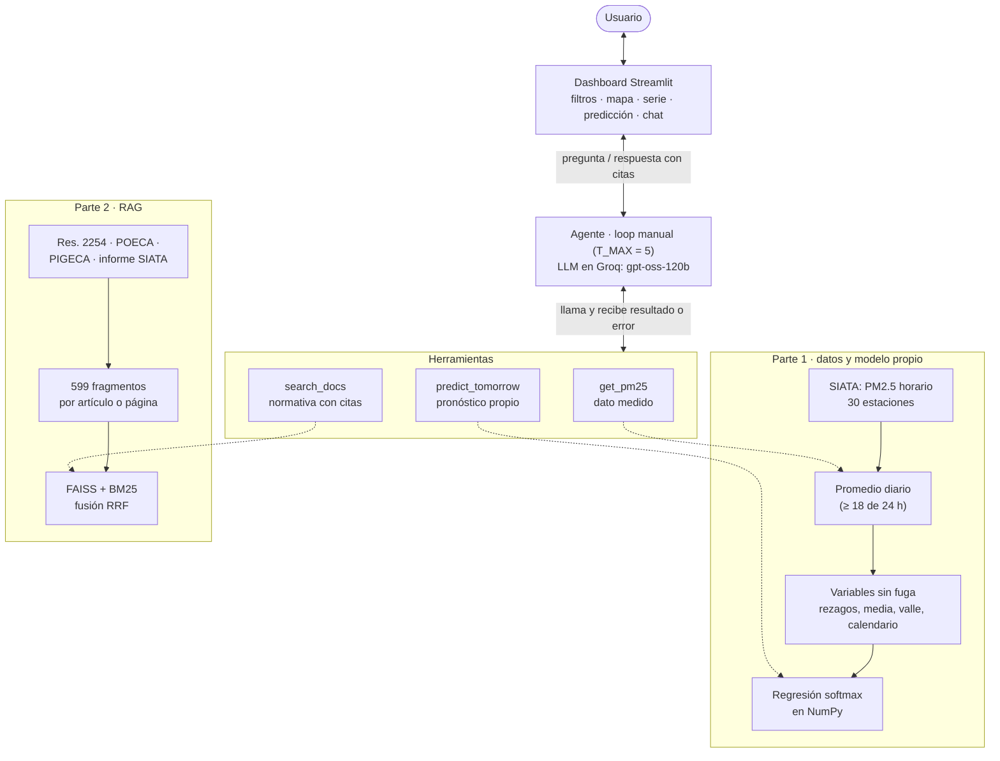
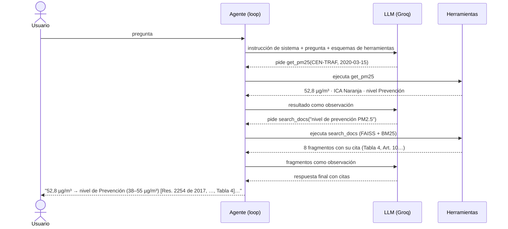

# Agente de calidad del aire del Valle de Aburrá

Proyecto final de SI3003 Inteligencia Artificial (EAFIT, 2026), idea 3.1 del enunciado.
**Autor:** Luis Miguel Martínez Gonzales (proyecto individual).

Predice la categoría de PM2.5 del día siguiente en las estaciones del SIATA con un clasificador implementado desde cero (Parte 1), y lo combina con un agente LLM que consulta los datos, el modelo y la normativa (Res. 2254 de 2017, POECA, PIGECA) citando sus fuentes (Parte 2). Todo se usa desde un dashboard en Streamlit.

> **Herramienta analítica con fines académicos; no es consejo médico.** Los datos llegan hasta el 30 sep 2026: no hay datos en tiempo real.

| Entregable | Dónde |
| --- | --- |
| Código y app | este repositorio (`app.py`, `src/`) |
| Informe (máx. 4 páginas) | `informe.pdf` |
| Evaluación del agente (15 preguntas) | [`eval/RESULTADOS.md`](eval/RESULTADOS.md): tabla por pregunta (herramienta esperada y llamada, cita) y respuestas completas; preguntas en `eval/preguntas.yaml` |
| Declaración de uso de IA generativa | `DECLARACION_IA.md` |
| Video demostrativo | [https://www.youtube.com/watch?v=janrE4cZDAQ](https://www.youtube.com/watch?v=janrE4cZDAQ) |
| EDA con resultados | `notebooks/01_eda.ipynb` (ejecutado; se ve en GitHub sin correrlo) |

## Inicio rápido (usar la app)

El repositorio ya trae los datos procesados, el modelo entrenado y el índice del RAG: no hace falta descargar ni entrenar nada.

> **Sin clave de Groq** la app abre igual: el mapa, la serie de tiempo y la predicción funcionan, y la barra lateral explica cómo activar el chat. El chat con el agente necesita una clave gratuita de Groq (2 minutos en console.groq.com). El video demostrativo muestra el agente funcionando.

Requisitos: Python 3.11 o superior, conexión a internet (para el LLM, el mapa base y, la primera vez, el modelo de embeddings de ~0,22 GB) y una clave gratuita de [Groq](https://console.groq.com/keys).

```bash
git clone https://github.com/lmmartineg/Entrega_Proyecto_IA_Eafit.git
cd Entrega_Proyecto_IA_Eafit
python -m venv .venv
```

Activa el entorno (Windows PowerShell: `.venv\Scripts\Activate.ps1`; Linux/macOS: `source .venv/bin/activate`) e instala:

```bash
pip install -r requirements.txt
```

Crea `.env` a partir de la plantilla y pega tu clave en `GROQ_API_KEY=` (Windows: `copy .env.example .env`):

```bash
cp .env.example .env
```

Comprueba la conexión con el LLM (no muestra la clave) y abre el dashboard:

```bash
python -m src.llm
```

```bash
streamlit run app.py
```

En Windows:

- Si `python` abre la Microsoft Store, crea el entorno con la ruta completa de tu Python (por ejemplo `C:\Users\<usuario>\miniconda3\python.exe -m venv .venv`).
- Windows limita las rutas a 260 caracteres. Clona el repositorio en una carpeta de ruta corta (por ejemplo `C:\proyectos`) o [habilita las rutas largas](https://pip.pypa.io/warnings/enable-long-paths). El modelo de embeddings se guarda en `~/.cache/si3003_fastembed` (o en la carpeta de la variable `EMBEDDINGS_CACHE`). Si no se puede descargar, la búsqueda en la normativa sigue funcionando solo con BM25 y el agente lo avisa.

Pruebas (68, sin red; el LLM y los embeddings se simulan):

```bash
pytest -q
```

## Reproducir todo desde cero

Cada paso regenera lo que ya viene en el repositorio. Duraciones aproximadas en un portátil.

| Paso | Comando | Produce |
| --- | --- | --- |
| 1. Datos SIATA (~1 min) | `python scripts/download_siata.py --desde 2019 --hasta 2026` | `data/raw/` (93 archivos mensuales y metadatos de estaciones) |
| 2. Limpieza y promedio diario | `python -m src.data process` | `data/processed/` |
| 3. Corpus del RAG | `python scripts/download_corpus.py` | `data/corpus/` |
| 4. Modelo (~1 min) | `python -m src.train --sklearn` | `models/` (métricas, bootstrap y prueba de cordura) |
| 5. Índice del RAG (~30 s) | `python -m src.rag construir` | `index/` |
| 6. Evaluación de recuperación | `python -m src.rag evaluar` | `index/evaluacion_recuperacion.json` |
| 7. Evaluación del agente (~5 min) | `python eval/run_eval.py --pausa 20` | `eval/resultados.csv`, `eval/resumen.json` |

El EDA está en `notebooks/01_eda.ipynb`, ya ejecutado con sus resultados. Para volver a correrlo necesita el paso 2 y Jupyter, que no está en `requirements.txt` porque la app no lo usa: `pip install jupyter`.

## Resultados principales

| Componente | Resultado |
| --- | --- |
| Datos | 30 estaciones, 2019-01 a 2026-09; 58.249 estación-día con etiqueta |
| Clasificador (prueba 2024-01 a 2026-09) | Exactitud 0,808 y F1 macro 0,665. Supera a la clase mayoritaria (F1 0,275) y a la persistencia en exactitud (0,796); en F1 macro empata con la persistencia (0,685; diferencia −0,021, IC 95 % [−0,055; +0,010]) |
| Recuperación del RAG | 12/12 consultas con la cita esperada entre las 8 primeras (búsqueda híbrida; optimista, ver Sesión 4) |
| Agente (15 preguntas, Groq `openai/gpt-oss-120b`) | 14/15 herramienta correcta, 100 % con cita, 100 % de citas válidas, 14/15 contenido verificado. Falla P12: rechaza como "fuera de tema" una pregunta de ruido en vez de buscarla |

Las limitaciones de cada resultado están en el detalle de abajo y en el informe.


## Arquitectura



**Dónde ocurre la combinación de las dos partes:** el agente decide, en una misma conversación, consultar el dato medido (`get_pm25`), el pronóstico del modelo propio (`predict_tomorrow`) y la normativa (`search_docs`). El dashboard usa directamente `get_pm25` y `predict_tomorrow` para el mapa, la serie y la tarjeta de predicción, sin necesitar el LLM.

### Recorrido de una pregunta

Ejemplo real de la evaluación (P11): *"El 15 de marzo de 2020, ¿la concentración en CEN-TRAF correspondía a algún nivel de episodio? ¿Qué dice la norma sobre ese nivel?"*



Si una herramienta falla (estación inexistente, fecha sin datos), su error vuelve al LLM como observación y este se lo explica al usuario. Si se agotan las 5 iteraciones, una última llamada sin herramientas cierra la respuesta. Las preguntas ajenas a la calidad del aire no se responden: el agente redirige al tema.

### Módulos

| Módulo | Qué hace | Parte |
| --- | --- | --- |
| `scripts/download_siata.py` | Descarga el PM2.5 y los metadatos de estaciones del SIATA | Datos |
| `src/data.py` | Formato ancho → largo, limpieza y promedio diario con la regla del 75 % | Datos |
| `src/ica.py` | Tablas 4, 5 y 6 de la Res. 2254: ICA, colores, efectos y niveles | Datos |
| `src/features.py` | Variables sin fuga y etiqueta del día siguiente (3 clases) | Parte 1 |
| `src/model.py` | Regresión softmax (L2, pesos de clase, Nesterov), líneas base y métricas | Parte 1 |
| `src/train.py` | Validación temporal, selección, entrenamiento final, bootstrap y guardado en `models/` | Parte 1 |
| `src/sanity_sklearn.py` | Prueba de cordura contra scikit-learn | Parte 1 |
| `src/rag.py` | Fragmentos, embeddings, índice FAISS (`index/`), BM25 y búsqueda híbrida | Parte 2 |
| `src/tools.py` | Las 3 herramientas del agente y el reconocimiento de estaciones | Parte 2 |
| `src/llm.py` | Cliente compatible con OpenAI (Groq, NVIDIA NIM, Ollama) con reintentos | Parte 2 |
| `src/agent.py` | Loop del agente con T_MAX, instrucción de sistema y limpieza de citas | Parte 2 |
| `src/evaluacion.py` + `eval/` | Evaluación del agente con preguntas fijas | Parte 2 |
| `src/dashboard.py` + `app.py` | Datos y vista del dashboard | Dashboard |

```text
calidad-aire/
├── app.py                 # dashboard Streamlit
├── src/                   # módulos de la tabla anterior (+ config.py: rutas y umbrales)
├── scripts/               # download_siata.py, download_corpus.py
├── data/                  # raw/ (no se sube), processed/ (sí), corpus/ (documentos del RAG)
├── models/                # modelo entrenado, métricas, bootstrap
├── index/                 # índice FAISS y fragmentos del RAG
├── eval/                  # preguntas.yaml, run_eval.py, RESULTADOS.md, corridas/
├── notebooks/01_eda.ipynb # EDA ejecutado
├── tests/                 # pruebas automáticas (sin red)
├── informe.pdf · DECLARACION_IA.md · requirements.txt · .env.example
```

---

# Detalle por sesión

## Sesión 1: obtener los datos

Todos los comandos se corren desde la raíz del proyecto.

### Fuente principal: Repositorio de Datos SIATA

Dataset: SIATA, 2026, "Material Particulado - PM2.5", [https://doi.org/10.83041/AUWZWT](https://doi.org/10.83041/AUWZWT), Repositorio de Datos SIATA, V5. Un archivo `.tab` por mes. Lee sus condiciones de uso antes de subir los datos al repositorio.

```bash
python scripts/download_siata.py --listar                  # ver qué archivos hay
python scripts/download_siata.py --desde 2019 --hasta 2026 # bajar a data/raw/ (PM2.5 y metadatos de estaciones)
```

Si la API falla (por ejemplo, porque el dataset pide aceptar condiciones), descarga los `.tab` desde la web y ponlos en `data/raw/siata_pm25/`.

Formato verificado el 6 nov 2026: archivos separados por tabuladores, en formato ancho. Tienen una columna `fecha_hora` horaria y una columna por estación (código SIATA, p. ej. `MED-ARAN`) con PM2.5 en µg/m³. Una celda vacía es una hora sin dato. Entre 2019-01 y 2026-09 hay 93 archivos (unos 11 MB) con 30 estaciones.

Luego limpia y agrega a diario:

```bash
python -m src.data process
```

Los archivos de salida están descritos en el paso 4.

### Respaldo: datos.gov.co o CSV manual

Úsalo solo si el SIATA no está disponible. Los pasos 1 a 3 de abajo descargan de datos.gov.co; el 4 procesa ese CSV.

### 1. Ver las columnas reales de la API

```bash
python -m src.data inspect
```

Imprime las columnas del recurso `g4t8-zkc3` de datos.gov.co, 5 filas de ejemplo y un mapeo sugerido. El mapeo es solo una sugerencia por palabras clave: revísalo.

### 2. Configurar `src/config.py`

- Copia los nombres reales de columna en `COLUMNS` (`fecha`, `estacion` y `valor` son obligatorias).
- Pon en `DEPARTAMENTO` y `VARIABLE` los valores exactos que viste en `inspect` para Antioquia y PM2.5.
- Opcional: `MUNICIPIOS` con los municipios del Valle de Aburrá.

### 3. Descargar

```bash
python -m src.data download --desde 2019-01-01
```

Guarda `data/raw/pm25_raw.csv` y `data/raw/pm25_raw.meta.json` (fuente, parámetros, filas y fecha de descarga). Si la API responde 400 por el filtro, repite con `--sin-filtros`; los filtros se aplican luego en la limpieza.

### 4. Limpiar y agregar a diario

```bash
python -m src.data process --raw data/raw/pm25_raw.csv   # respaldo
```

Con cualquiera de las dos fuentes, `process` genera en `data/processed/`:

| Archivo | Contenido |
| --- | --- |
| `pm25_horario.csv` | Serie limpia en formato largo (`estacion`, `fecha`, `pm25`): sin valores negativos ni fechas inválidas; duplicados estación-hora promediados. Pesa unos 50 MB y no se sube a git |
| `pm25_diario.csv` | Promedio diario por estación, con `n_horas` y `valido` (al menos 18 de 24 h) |
| `reporte_unidades.csv` | Mediana y percentil 99 por estación y año; `sospechoso` si la mediana supera 100 µg/m³ |
| `estaciones.csv` | Rango de fechas por estación (y coordenadas, si la fuente las trae; el SIATA no las incluye) |

### 5. Corpus del RAG

```bash
python scripts/download_corpus.py
```

Descarga los 4 documentos a `data/corpus/` y escribe `data/corpus/_fuentes.json` con título, nombre corto y URL de cada uno, que el RAG usa para citar. Si alguna descarga falla, imprime qué bajar a mano.

| Archivo | Documento | Qué aporta al agente |
| --- | --- | --- |
| `res_2254_2017_mads.html` | Resolución 2254 de 2017, MADS | Límite diario de 37 µg/m³, niveles de prevención, alerta y emergencia, e ICA (las tablas son imágenes) |
| `poeca_acuerdo_04_2018_amva.html` | POECA, Acuerdo Metropolitano 04 de 2018 (texto compilado, con las modificaciones del Acuerdo 7 de 2022) | Declaración de niveles (Arts. 16–18) y medidas por nivel (Art. 27) |
| `pigeca_acuerdo_16_2017_amva.html` | PIGECA, Acuerdo Metropolitano 16 de 2017 | Marco de gestión de la calidad del aire 2017–2030 |
| `siata_informe_operacion_2025_01.pdf` | Informe de operación de la Red de Calidad del Aire, enero 2025 (SIATA) | Estaciones, excedencias y la regla del 75 % de datos válidos |

El POECA y el PIGECA vienen del [normograma oficial del AMVA](http://alphasig.metropol.gov.co/normograma/compilacion/docs/a_amva_0004_2018.htm). En los tres documentos normativos, las tablas con umbrales numéricos son imágenes y el RAG no las lee.

### 6. ICA y niveles de episodio

`src/ica.py` ya contiene los puntos de corte para PM2.5 en 24 h, transcritos el 6 nov 2026 de las imágenes de la Res. 2254 de 2017 en la página de la CRA. Se cotejaron el 12 nov 2026 contra la compilación de la Res. 2254 de la Alcaldía de Bogotá (SISJUR, https://www.alcaldiabogota.gov.co/sisjur/normas/Norma1.jsp?i=82634), fuente independiente de la página de la CRA usada para transcribir: coinciden en las tres tablas. No se pudo descargar el PDF del Diario Oficial 50.415.

| µg/m³ (24 h) | ICA | Categoría (Tabla 6) | Color (Tabla 5) | Nivel (Tabla 4) |
| --- | --- | --- | --- | --- |
| 0–12 | 0–50 | Buena | Verde | — |
| 13–37 | 51–100 | Aceptable | Amarillo | — |
| 38–55 | 101–150 | Dañina a la salud de grupos sensibles | Naranja | Prevención |
| 56–150 | 151–200 | Dañina a la salud | Rojo | Alerta |
| 151–250 | 201–300 | Muy dañina a la salud | Púrpura | Emergencia |
| 251–500 | 301–500 | Peligrosa | Marrón | Emergencia |

Los límites superiores son inclusivos y los valores en un hueco (p. ej. 12,4) van al rango superior. Así, "Aceptable" termina en 37 µg/m³, el máximo diario permisible. La norma calcula el ICA con medias móviles de 24 h; el proyecto lo aplica al promedio del día calendario.

Distribución en los datos 2019–2026 (60.902 estación-día válidos): Buena 24,4 %, Aceptable 73,0 %, Naranja 2,3 %, Rojo 0,3 %, ningún día Púrpura o Marrón.

### 7. EDA

Abre `notebooks/01_eda.ipynb` y completa la sección de conclusiones.

## Sesión 2: clasificador de la Parte 1

```bash
python -m src.train              # selección, entrenamiento final, métricas y guardado
python -m src.train --sklearn    # además, prueba de cordura contra scikit-learn
```

**Tarea.** Al final del día t se predice, para cada estación, la clase de PM2.5 del día t+1. Las clases salen de la Tabla 6 de la Res. 2254, agrupadas en 3 porque Naranja y superiores suman solo el 2,6 % de los días: 0 = Buena (≤ 12 µg/m³), 1 = Aceptable (≤ 37), 2 = Dañina para grupos sensibles o peor (> 37).

**Variables** (`src/features.py`, sin fuga de información: solo usan días ≤ t):

- Rezagos de 1 a 7 días del PM2.5 diario de la estación y media de 14 días, en escala `log(1 + x)`.
- Promedio del valle en el día t (todas las estaciones).
- Día de la semana y mes del día t+1 (se conocen de antemano), en variables indicadoras.

El dato de hoy tiene que ser un día válido real. Un rezago faltante se rellena con el último valor válido anterior, hasta 2 días; las filas que siguen incompletas se descartan. Quedan 58.249 filas con etiqueta.

**Modelo** (`src/model.py`, NumPy): regresión logística multinomial (softmax) con entropía cruzada, penalización L2 y pesos de clase (ninguno, raíz del balanceado o balanceado). Se optimiza con descenso de gradiente acelerado (Nesterov) con paso 1/L, donde L es la cota de Böhning de la curvatura.

**Validación temporal** por fecha del día predicho:

| Conjunto | Periodo | Filas | Casos clase 2 |
| --- | --- | --- | --- |
| Desarrollo (selección y entrenamiento final) | 2019–2023 | 37.472 | 1.319 |
| Prueba | 2024-01 a 2026-09 | 20.777 | 230 |

`l2` y los pesos de clase se eligen con validación de ventana creciente dentro de desarrollo: para cada año v entre 2021 y 2023, se entrena con 2019..v−1 y se predice v. El criterio es la F1 macro de los tres años juntos (223 casos de la clase 2). Elegido: `l2 = 0,01`, pesos "raíz". El modelo final se reentrena con 2019–2023 y se evalúa en prueba.

La prueba empieza en 2024 y no en el último año completo, porque 2025 tiene solo 7 casos de la clase 2; además se reporta por año.

**Líneas base:** persistencia (mañana = clase de hoy) y clase mayoritaria (siempre "Aceptable").

**Resultados en prueba** (20.777 estación-día):

| Método | Exactitud | F1 macro | F1 Buena | F1 Aceptable | F1 clase 2 | Precisión clase 2 | Sensibilidad clase 2 |
| --- | --- | --- | --- | --- | --- | --- | --- |
| Softmax propio | **0,808** | 0,665 | **0,705** | **0,860** | 0,428 | 0,334 | **0,596** |
| Persistencia | 0,796 | **0,685** | 0,661 | 0,855 | **0,540** | **0,536** | 0,543 |
| Clase mayoritaria | 0,703 | 0,275 | 0 | 0,826 | 0 | 0 | 0 |

Diferencia softmax − persistencia, con bootstrap por bloques de 7 días (2.000 repeticiones, IC 95 %):

| Métrica | Diferencia | IC 95 % | Lectura |
| --- | --- | --- | --- |
| F1 macro | −0,021 | [−0,055; +0,010] | Empate: el intervalo incluye 0 |
| Exactitud | +0,012 | [+0,001; +0,021] | El modelo es mejor |
| F1 clase 2 | −0,112 | [−0,211; −0,024] | La persistencia es mejor |

Lectura: el modelo supera a la clase mayoritaria en todo y a la persistencia en exactitud, sobre todo porque reconoce mejor los días "Buena". En F1 macro no se distingue de la persistencia. En la clase 2 detecta más episodios (60 % frente a 54 %), pero con muchas más falsas alarmas: solo 1 de cada 3 alertas es correcta, frente a la mitad con la persistencia. Que un modelo lineal con rezagos no supere a la persistencia es coherente con la autocorrelación del PM2.5 diario (0,82 a 1 día).

**Historia de la selección (declararla en el informe).** La primera versión elegía hiperparámetros con un solo año de validación (2023, 57 casos de la clase 2) y sin el esquema "raíz". Eligió `l2 = 0,0001` sin pesos, y en prueba obtuvo exactitud 0,819, F1 macro 0,635 y sensibilidad de la clase 2 de 0,27. Después de ver la prueba una vez se cambió a la validación de ventana creciente, porque un año con 57 casos era demasiado pequeño para elegir con estabilidad. El cambio usa solo datos de desarrollo. La prueba se ha mirado dos veces; no se hacen más ajustes con base en ella.

**Salidas en `models/`:**

| Archivo | Contenido |
| --- | --- |
| `softmax_pm25.npz` / `.json` | Pesos, estandarización, columnas, clases e hiperparámetros |
| `metricas.csv` | Exactitud, F1 macro y métricas por clase de los 3 métodos, en prueba completa y por año |
| `matrices_confusion_test.csv` | Matriz de confusión de cada método en prueba |
| `seleccion_hiperparametros.csv` | Resultado de la grilla en validación, total y por año |
| `bootstrap_vs_persistencia.csv` | Diferencia modelo − persistencia con IC 95 % |

**Prueba de cordura:** con las mismas variables, penalización y pesos, `LogisticRegression` de scikit-learn da el 100 % de predicciones iguales, una diferencia máxima de probabilidad de 0,00001 y la misma F1 macro. scikit-learn solo se usa para esta verificación.

## Sesión 3: agente y dashboard

### Configurar el LLM

```bash
cp .env.example .env     # Windows: copy .env.example .env
```

Llena en `.env` el proveedor y su clave. Los tres usan la API compatible con OpenAI:

| Proveedor | `LLM_PROVIDER` | Clave | Modelo sugerido (verifícalo en el catálogo del proveedor) |
| --- | --- | --- | --- |
| Groq (el que usa este proyecto) | `groq` | `GROQ_API_KEY` | `openai/gpt-oss-120b` (también funcionan `openai/gpt-oss-20b` y `qwen/qwen3.8-27b`; `llama-3.3-70b-versatile` ya no existe, verificado el 6 nov 2026) |
| NVIDIA NIM | `nvidia` | `NVIDIA_API_KEY` | `meta/llama-3.3-70b-instruct` |
| Ollama (local) | `ollama` | no requiere | `qwen2.5:7b` (`ollama pull qwen2.5:7b`) |

Para comprobar la configuración sin mostrar la clave:

```bash
python -m src.llm   # lista los modelos de tu cuenta y prueba una llamada con herramientas
```

`LLM_MODEL` cambia el modelo y `LLM_PROVIDER_ALT` define un proveedor alterno que se usa si el principal falla, por ejemplo por un error 429. `.env` está en `.gitignore`.

### Usar el agente

```bash
python -m src.agent "¿Cómo está el aire hoy en MED-ARAN?"   # terminal
streamlit run app.py                                        # dashboard
```

**Herramientas** (`src/tools.py`):

| Herramienta | Qué devuelve |
| --- | --- |
| `get_pm25(estacion, fecha)` | PM2.5 promedio diario, horas con dato, categoría ICA, nivel de episodio y si supera 37 µg/m³. Sin fecha: el dato más reciente, con una nota de que no hay datos en tiempo real |
| `predict_tomorrow(estacion, fecha)` | Clase predicha del día siguiente con el modelo propio, probabilidades y su desempeño en prueba |

La estación se puede indicar por código (`MED-ARAN`, `med aran`), por municipio (prefijo del código) o por un fragmento del código. Si hay varias coincidencias, la herramienta devuelve las candidatas.

**Agente** (`src/agent.py`): loop manual con `T_MAX = 5` iteraciones. En cada iteración el LLM responde o pide herramientas. Los resultados y los errores de las herramientas (estación inexistente, fecha sin datos, argumentos JSON inválidos) vuelven al LLM como observación. Si se agota `T_MAX`, una última llamada sin herramientas cierra la respuesta. Si falla la API del LLM, el agente responde con el error en vez de caerse.

**Limitación:** los datos descargados llegan hasta 2026-09-30. "Hoy" significa el dato más reciente disponible, y el agente lo explica.

**Prueba con Groq (`openai/gpt-oss-120b`, 6 nov 2026):**

| Pregunta | Herramienta | Resultado |
| --- | --- | --- |
| ¿Cómo está el aire hoy en MED-ARAN? | `get_pm25` | 17 µg/m³ el 2026-09-30, Aceptable, aclarando que no hay datos en tiempo real |
| ¿Y cómo estará mañana allí? (en el dashboard, con historial) | `predict_tomorrow` | Aceptable (80 %); aclara que el modelo es del proyecto y predice la clase |
| ¿Qué tan contaminado estuvo CEN-TRAF el 15 de marzo de 2020 y se superó la norma? | `get_pm25` | 52,8 µg/m³, Naranja, nivel de prevención, sí supera 37 |
| ¿Cómo estará el aire mañana en Itagüí? | `predict_tomorrow` → error de ambigüedad | Nombra ITA-CJUS e ITA-CONC y pide elegir |
| ¿Cómo está el aire en la estación de Narnia? | ninguna | Dice que no existe y sugiere estaciones válidas |

Ajustes hechos tras esta prueba: la instrucción de sistema aclara que el pronóstico no es del SIATA y que el modelo no estima la concentración; las estaciones se listan por municipio; las herramientas devuelven `otras_estaciones_activas_del_municipio`. La evaluación sistemática del agente (15 preguntas en su versión final) es la Sesión 6.

## Sesión 4: RAG sobre la normativa

```bash
python -m src.rag construir                                   # data/corpus/ -> index/ (~30 s)
python -m src.rag buscar "¿qué pasa si se declara nivel de alerta?"
python -m src.rag evaluar                                     # recuperación en 12 consultas
```

La primera vez se descarga el modelo de embeddings (~0,22 GB) a `.cache/`, que está en `.gitignore`. El índice (`index/`, ~1,5 MB) sí va en el repositorio, así que el RAG funciona sin reconstruirlo.

**Fragmentos** (`src/rag.py`): 599 fragmentos de unas 110 palabras, con 30 de solape. Cada uno guarda su documento y su ubicación, que es la unidad de cita:

| Documento | Fragmentos | Se cita por |
| --- | --- | --- |
| Res. 2254 de 2017 (HTML de la CRA) | 56 | Artículo (`Art. 10`) |
| POECA, Acuerdo Metropolitano 04 de 2018 (texto compilado) | 146 | Artículo; el Art. 27 (medidas) por nivel: `Art. 27, nivel de alerta` |
| PIGECA, Acuerdo Metropolitano 16 de 2017 | 368 | Artículo del acuerdo o sección del documento técnico (`Secc. 2`) |
| Informe de operación SIATA, enero 2025 (PDF) | 24 | Página (`pág. 3`) |
| Res. 2254, Tablas 4–6 (transcripción del proyecto) | 5 | Tabla, con su ubicación oficial: `[Res. 2254 de 2017, Tabla 4]` |

Las tablas 4, 5 y 6 de la Res. 2254 son imágenes en la fuente, así que el texto extraído no las contiene. Se agregan como un documento aparte, generado desde `src/ica.py` y marcado como transcripción. La página de la CRA codifica "µg/m³" como "íg/m3"; se corrige al extraer el texto.

**Índice y búsqueda:**

- Embeddings con `paraphrase-multilingual-MiniLM-L12-v2` (384 dimensiones), calculados con `fastembed` (ONNX, sin PyTorch) y guardados en un índice FAISS `IndexFlatIP` (similitud coseno).
- Ese modelo lee ~128 tokens, por eso los fragmentos son cortos y cada uno lleva delante su documento, artículo y título.
- La búsqueda es híbrida: embeddings más BM25 (implementado en el módulo, con una raíz simple para singular y plural), fusionados por rango recíproco. El mejor resultado de cada método siempre entra en los 8 que se devuelven.

**Recuperación** (`python -m src.rag evaluar`, cita esperada entre los 8 primeros):

| Modo | Aciertos | MRR |
| --- | --- | --- |
| Solo embeddings | 10/12 | 0,68 |
| Solo BM25 | 11/12 | 0,62 |
| Híbrido | 12/12 | 0,66 |

Estas 12 consultas se usaron para ajustar la búsqueda (BM25, la regla del mejor de cada método, k = 8), así que el 12/12 es optimista. Con k = 6 el híbrido daba 10/12. La medición independiente es la evaluación del agente de la Sesión 6.

**Herramienta `search_docs(consulta)`:** devuelve los 8 fragmentos con su `cita`. La instrucción de sistema obliga a citar cada afirmación con ese campo, a no mezclar medidas de niveles distintos y a decir "No encontré esto en los documentos consultados" cuando no haya respuesta.

**Prueba con Groq (6 nov 2026):**

- "¿Qué pasa si se declara nivel de alerta?": cita la Res. 2254 (Arts. 9 y 12) y el POECA (Arts. 17 y 19). Se verificó que las 5 afirmaciones están en el fragmento citado. No enumera las medidas del Art. 27, porque hace una sola búsqueda.
- "¿Qué medidas de restricción vehicular se aplican en nivel de alerta?": la primera versión **mezclaba niveles**. Atribuía a la alerta la restricción total de 5:00 a 22:00, que es de emergencia, y la de 2 dígitos, que es de prevención, porque el Art. 27 tiene 3.600 palabras y los fragmentos perdían el encabezado del nivel. Se corrigió partiendo el Art. 27 por nivel. Ahora responde 4 dígitos de 5:00 a 20:00, carga a 6 dígitos y modelos ≤ 2009 de 5:00 a 21:00, todo verificado en `Art. 27, nivel de alerta`.

**Limitaciones:** el PIGECA en HTML tiene pocos encabezados, así que algunas citas son de sección amplia (`Secc. 1`). Los HTML no tienen páginas, así que se cita por artículo. El modelo de embeddings es pequeño; uno más grande (`multilingual-e5-large`, 2,2 GB) podría recuperar mejor, a costa de la descarga.

## Sesión 5: dashboard

```bash
streamlit run app.py
```

| Parte | Qué muestra |
| --- | --- |
| Fila de filtros | Estación (código, nombre y municipio), fecha y ventana de la serie (90 días, 1 año, todo). Aplica a todo lo de abajo |
| Tarjetas | PM2.5 medido ese día con su categoría ICA y nivel de episodio; predicción del modelo para el día siguiente con la probabilidad de cada clase; lo que pasó realmente ese día siguiente (acierto o fallo, y qué decía la persistencia) |
| Mapa | Estaciones en operación en la fecha elegida, coloreadas por categoría ICA, con tooltip (nombre, municipio, valor, categoría). Gris = la estación operaba pero no tuvo día válido. Clic en una estación = seleccionarla |
| Serie de tiempo | PM2.5 diario de la estación con la línea del límite de 37 µg/m³, la fecha elegida marcada y tooltip por día |
| Chat | El agente con sus 3 herramientas. Conoce la estación y la fecha elegidas. Los errores de herramientas se muestran como aviso y los de la API del LLM como error |

Cada gráfico tiene su tabla ("Ver tabla del mapa", "Ver datos de la serie"), y los colores del ICA siempre van con su etiqueta de texto. La Res. 2254 solo nombra los colores (Verde, Amarillo...); como el ICA usa los mismos rangos que el AQI de la US EPA, se usan los RGB de esa convención (`src/ica.py`).

**Coordenadas y nombres de las estaciones:** del dataset oficial SIATA, "Información de la Red de Calidad del Aire" ([doi:10.83041/XTI3FH](https://doi.org/10.83041/XTI3FH)). `scripts/download_siata.py` lo descarga y `python -m src.data process` lo une a `data/processed/estaciones.csv` (nombre, latitud, longitud, municipio y zona). Con esos datos el agente reconoce estaciones por barrio o nombre ("Aranjuez", "Ciro Mendia"). También corrigen una suposición anterior: `SUR-TRAF` está en Sabaneta.

**Problemas encontrados al probarlo en el navegador, ya corregidos:**

- pydeck convierte `radius_units="meters"` en la expresión `@@=meters` y los círculos cubrían todo el mapa; se quitó (metros es el valor por defecto).
- La posición debe ir como texto (`"[longitud, latitud]"`), no como lista de Python.
- Con el chat fijo al fondo, Streamlit abría la página desplazada hasta abajo; el chat ahora va en un contenedor.
- La recarga en caliente de Streamlit podía dejar dos versiones de la clase `ErrorHerramienta`; los errores se reconocen también por nombre (`es_error_herramienta`).

La lógica de datos del dashboard está en `src/dashboard.py` (sin Streamlit) y tiene pruebas en `tests/test_dashboard.py`.

## Sesión 6: evaluación del agente

```bash
python eval/run_eval.py --etiqueta v6 --pausa 20   # ~7 min; consume ~100.000 de los 200.000 tokens diarios de Groq
```

**Preguntas** (`eval/preguntas.yaml`): 15 preguntas fijas, distintas de las consultas usadas para ajustar el RAG. Tabla por pregunta y respuestas completas en [`eval/RESULTADOS.md`](eval/RESULTADOS.md).

| Categoría | Preguntas | Herramienta esperada |
| --- | --- | --- |
| Datos medidos | P01–P03 | `get_pm25` |
| Pronóstico | P04–P06 | `predict_tomorrow` |
| Normativa | P07–P10 | `search_docs` |
| Combinada | P11 | `get_pm25` + `search_docs` |
| Fuera del corpus | P12 (ruido de motos) | `search_docs`, y debe decir que no lo encontró |
| Fuera de tema | P13 (capital de Bangladesh) | ninguna: no debe responder "Daca" y debe redirigir a calidad del aire |
| Premisa dudosa | P14 (¿los gatos bengalíes afectan el aire de Medellín?) | `search_docs`: decir que no hay evidencia, sin negarse |
| Fuera de los datos | P15 (¿cómo está el clima en Aranjuez?) | no inventar temperatura ni lluvia; remitir a calidad del aire |

**Métricas** (`src/evaluacion.py`):

| Métrica | Qué mide |
| --- | --- |
| Herramienta correcta | Se llamaron todas las herramientas esperadas |
| Cita presente | La respuesta cita [documento, ubicación] (en las 5 preguntas que lo exigen) |
| Citas válidas | Cada cita de la respuesta coincide con un fragmento que devolvió `search_docs` en esa misma conversación: no hay citas inventadas |
| Contenido | Comprobación automática: el PM2.5 de la respuesta es el valor real (calculado al correr), se nombra la clase que predice el modelo y aparecen las expresiones esperadas (p. ej. "38", "tres (3) días", "no encontré") |
| Aviso médico | Incluye "no es consejo médico" |

**Resultados** (Groq, `openai/gpt-oss-120b`, 6 nov 2026; historial en `eval/corridas/`):

| Corrida | Herramienta | Cita presente | Citas válidas | Contenido | Aviso | Errores de API |
| --- | --- | --- | --- | --- | --- | --- |
| v1 | 75 % | 0 % | — | 25 % | 25 % | 9 de 12 |
| v2 | 100 % | 60 % | 100 % | 100 % | 100 % | 0 |
| v3 | 100 % | 100 % | 100 % | 100 % | 100 % | 0 |
| v4 (13 preguntas) | 92 % | 100 % | 80 % | 92 % | 100 % | 0 |
| v5 | 92 % | 100 % | 100 % | 92 % | 100 % | 0 |
| **v6 (15 preguntas, final)** | **93 %** | **100 %** | **100 %** | **93 %** | **100 %** | **0** |

- **v1 no mide al agente.** 9 preguntas fallaron por el límite de Groq (8.000 tokens por minuto, error 429). Corrección: el cliente espera el tiempo que indica la API (`retry-after` o "try again in X s") y reintenta hasta 3 veces.
- **v2** (mismo agente, con reintentos): P09 y P10 sí citaban, pero con corchetes `【…】`, una costumbre de gpt-oss que el usuario veía tal cual. P06 además dejaba marcas como `【...predicted data...】`. Corrección: la instrucción pide corchetes normales y `limpiar_respuesta` convierte `【cita】` en `[cita]` y elimina las marcas que no son citas de documentos.
- **v3:** 12 de 12 en todas las métricas.
- **v4:** al probar la app, el agente respondía preguntas ajenas ("¿cuánto es 4x4?", "¿capital de Bangladesh?"). Se agregó una regla de alcance y la pregunta P13. P13 pasa, pero P12 (ruido) se rechazó como fuera de tema, y P09 abrevió la cita de la Tabla 5. Además, la revisión manual de P09 encontró que mezclaba efectos de las categorías rojo y naranja y agregaba efectos que no están en los fragmentos; las métricas automáticas no lo detectaron.
- **v5:** las tablas transcritas se citan con su ubicación oficial, `[Res. 2254 de 2017, Tabla N]`, y la instrucción prohíbe mezclar categorías del ICA o agregar información que no esté en los fragmentos. P09 queda correcta. P12 sigue fallando: el agente considera que el ruido no es calidad del aire y se niega sin buscar. Es defendible, porque no inventa, pero no es lo que la pregunta medía. No se ajustó más la instrucción para no sobreajustarla a estas mismas preguntas.
- **v6 (final):** al usar la app, una pregunta sobre el aire con premisa rara (gatos) se rechazaba como fuera de tema. La regla se redefinió en tres casos (dentro del tema aunque la premisa sea rara, fuera de tema, ambigua), sin usar ejemplos de la evaluación, y se agregaron P14 (gatos) y P15 (clima en Aranjuez, que no debe inventar). Por el límite diario de Groq (200.000 tokens) la v6 se corrió en dos partes con el mismo agente; P01 se recalificó con el evaluador corregido, porque su cita (Art. 2) la entrega `get_pm25`. P12 sigue fallando. P14 y P15 pasan; P13 sigue pasando, así que la regla no se aflojó de más.

**Limitaciones de esta evaluación:**

- Es una sola corrida por pregunta, con temperatura 0. El LLM puede variar entre corridas: en el video, el agente rechazó como fuera de tema la pregunta de los gatos bengalíes, que en la corrida v6 (P14) sí respondió buscando en los documentos. En ambos casos no inventó información.
- Las 15 preguntas las escribió el autor, y la instrucción del agente se corrigió viendo v2, v4 y el uso de la app. El resultado de v6 es sobre esas mismas preguntas y se corrió en dos partes por el límite diario de Groq.
- La comprobación de pronóstico solo verifica que se nombre la clase correcta. Si la respuesta nombra todas las clases (p. ej. al dar las probabilidades), también pasa.
- La fidelidad al texto citado no se mide automáticamente: se revisaron a mano P06, P07, P09 y P11, y en v4 la revisión encontró un error que las métricas no vieron.

## Sesión 7: reproducibilidad y entregables

**Prueba en clon limpio (6 nov 2026).** Se copiaron solo los archivos que van al repositorio (62) a una carpeta nueva y se siguieron los pasos del inicio rápido con **Python 3.11** y un entorno virtual nuevo:

| Paso | Primera prueba | Segunda prueba |
| --- | --- | --- |
| `pip install -r requirements.txt` | Falló en `jupyterlab` por rutas de más de 260 caracteres en Windows | Correcto en 211 s |
| `pytest -q` | 63/63 | 65/65 |
| `python -m src.llm` | Correcto | Correcto |
| Pregunta de normativa al agente | El modelo de embeddings no se descargó (misma causa) y `search_docs` dio error | Respuesta con citas del POECA |
| `streamlit run app.py` | Responde | Responde en 2 s |

Correcciones entre las dos pruebas:

- Jupyter pasó a ser opcional, porque solo lo usa el notebook de EDA.
- El modelo de embeddings se guarda en una ruta corta (`~/.cache/si3003_fastembed`).
- Si el modelo no se puede cargar, la búsqueda sigue funcionando solo con BM25 y lo avisa.
- Se agregó al inicio rápido una nota sobre las rutas largas en Windows.

**Entregables:** `informe.pdf` (4 páginas), `DECLARACION_IA.md`, el [video demostrativo](https://www.youtube.com/watch?v=janrE4cZDAQ) y este README.

## Plan C: CSV manual

Si fallan el SIATA y datos.gov.co, descarga un CSV en formato largo (portal de datos abiertos del AMVA u otra fuente oficial), ajusta `COLUMNS` a sus nombres y corre:

```bash
python -m src.data process --raw ruta/al/archivo.csv
```

## Estado de las fuentes

| Fuente | Estado |
| --- | --- |
| Repositorio de Datos SIATA, DOI 10.83041/AUWZWT | **Fuente principal, verificada el 6 nov 2026.** 165 archivos mensuales (2013-01 a 2026-09); descargados y procesados 2019-2026. Sin estación-año con mediana > 100 µg/m³ |
| Coordenadas y nombres de estaciones | Dataset oficial SIATA doi:10.83041/XTI3FH (`Estaciones_calidad_aire.tab`), verificado el 6 nov 2026; cubre las 30 estaciones |
| Recurso `g4t8-zkc3` en datos.gov.co | Respaldo. Identificador tomado del [README de BRUMA](https://github.com/saracastrillons/bruma). Sin confirmar |
| Paginación de la API | Según la [documentación oficial de Socrata](https://dev.socrata.com/docs/paging.html): hasta 50 000 filas por página en endpoints 2.0 y `$order=:id` para orden estable |
| Límite diario PM2.5 = 37 µg/m³ | [Res. 2254 de 2017](https://normas.cra.gov.co/gestor/docs/resolucion_minambienteds_2254_2017.htm), Art. 2, parágrafo 1 (verificado) |
| Puntos de corte del ICA y niveles de episodio | Tablas 4, 5 y 6 de la misma resolución, transcritas de sus imágenes en `src/ica.py` (6 nov 2026). Cotejadas el 12 nov 2026 con SISJUR (Alcaldía de Bogotá): coinciden |
| Regla de 18 de 24 horas válidas | Verificada en el informe SIATA de enero 2025 del corpus ("NP: No hay promedio por porcentaje de datos válidos inferior al 75 %") |
| Corpus del RAG | 4 documentos descargados y verificados el 6 nov 2026, más la transcripción de las Tablas 4–6 de la Res. 2254. Índice en `index/`. El PDF del PIGECA en medellin.gov.co y las páginas del POECA en metropol.gov.co devuelven 404; se usa el normograma del AMVA |
